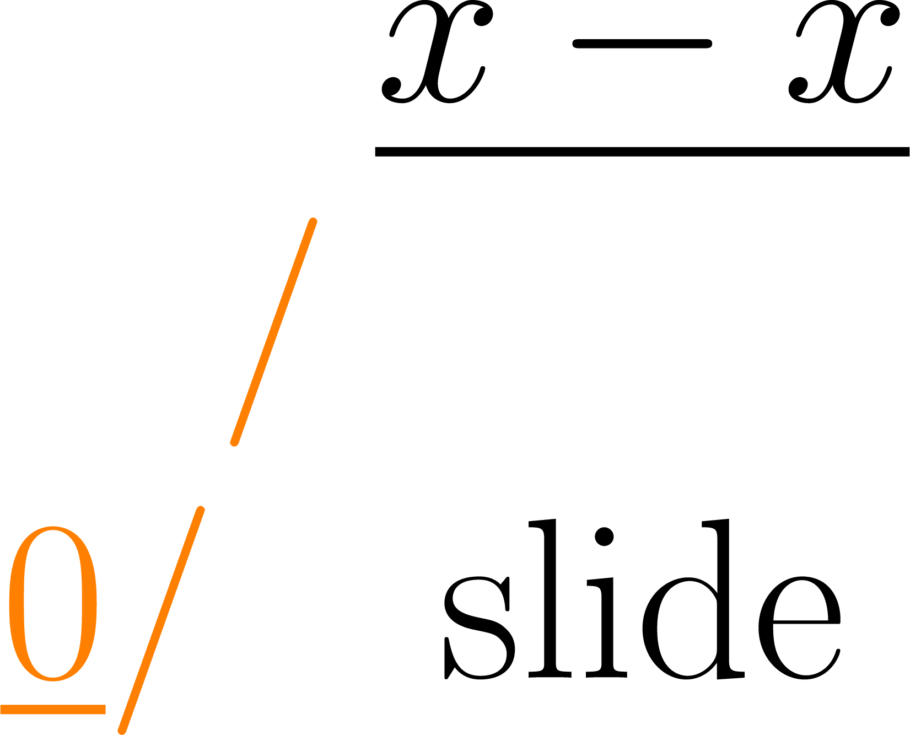

<p align="center">
  
</p>

# slide

[](https://travis-ci.com/yslide/slide)
[](https://crates.io/crates/slide)
[](https://github.com/yslide/slide/issues?q=is%3Aissue+is%3Aopen+label%3A%22help+wanted%22)

slide is archived because I don't have too much time to work on it these days.
I do want to get back to it eventually, though. For the interested, here are some
thoughts on what can be done differently:

- I think editor integration is key. Realistically a tool like this is something
  you want free-form input to, like WolframAlpha, but also run over a document, e.g.
  a TeX buffer or an OCR-ed page. I'm happy with how the current editor integration
  works, but more than LSP is needed - only software people know what that is.
- Rewrite rules are not the right approach. You run into the phase ordering problem
  really quickly. At some point I had ideas about using a lightweight model to drive
  phase ordering heuristically. This is promising, but useless below a critical mass.
  I think what you really want here are e-graphs, or similar tools that preserve
  expression state while applying transformations without loss.
- Algorithmic evaluation rules are right approach. That's the stuff in the "math"
  module. The idea is that eventually you do want to be able to do stuff like [factor
  out polymonial divisors](./libslide/src/math/gcd_poly_zz.rs) - that's what drives
  the basis example below.
  - A good question is how to order such evaluation rules, because they can't always be
    translated to equivalence relations in an e-graph trivially. You might want to
    run them when an e-graph gets stuck. In general you just keep going until you hit
    a constant state.
- Performance is not a problem, at all really. These tools are meant to be used real-time.
  Humans can't tell apart cycles. Your inpust are also tiny, so be okay with wasting work,
  even a lot of it, if it gets better results. I really just don't see performance being
  a problem until you get to higher-dimensional mathematics. But for this kind of
  high-school algebra it's fine.
- Be okay with giving up dense representations very quickly. This was a mistake I made.
  Really you only want to represent the smallest polynomials densely. As soon as you have
  a high-order polynomial, it's likely to only grow larger; just represent it sparsely.

slide is an expression rewrite system and validator. Given an expression like

```math
x(x + 2 * 3) / (x + 6)
```

slide should be able emit the simplified expression `x`.

slide's design goals include

- Simplification as a platform, where rewrite rules are user-configurable.
    For example, you should be able to give to (or remove from!) slide a rule like `x^2 dx -> 2x`,
    and slide will incorporate the rule in reducing an expression.
    This can be thought of analogously to tunable optimizations in a compiler.
- Support for interactive user interfaces, including text editor features for
    documents like Tex in text editors. More information on this is described
    [below](#editor-support).
- Validation of statement correctness.

## Usage

slide is ready for very early use. The easiest way to try out slide is via our
[web UI](https://yslide.github.io).

Binaries can be downloaded from the [repository
releases](https://github.com/yslide/slide/releases) or installed with `cargo`:

```
cargo install slide --version 0.0.1
# This should set slide in your path; for usage information, try
slide --help
```

### Editor Support

slide has a language server and supports additional integration with some text editors,
providing analysis and simplification of mathematical expressions in documents.
For more information, see the [editor](./editor) directory.

## Contributing

Lots of features are still incomplete; please
[file an issue](https://github.com/yslide/slide/issues/new) when you see something that could be
improved. This is one of the best (and easiest!) ways to contribute to slide.

All contributions are warmly welcomed. For more information, including how to contribute to the
development of slide, see our [contribution docs](./CONTRIBUTING.md).

## libslide

The slide project exposes its library publicly, providing an API you can embed in your other Rust
apps. To add `libslide` to your project, ensure the following in your `Cargo.toml`:

```
libslide = "0.0.1"
```
